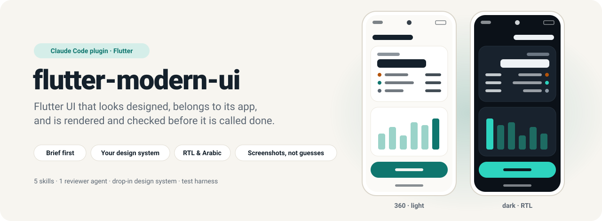
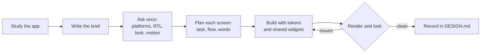

<div align="center">

<picture>
  <source media="(prefers-color-scheme: dark)" srcset="docs/assets/banner-dark.svg">
  
</picture>

[](https://github.com/m3n99/flutter-ui-skills/actions/workflows/ci.yml)


**[Install](#install)** · **[Use](#use)** · **[How it works](#how-it-works)** · **[What's inside](#whats-inside)** · **[Changelog](CHANGELOG.md)**

</div>

## What it is

A Claude Code plugin that makes Claude build Flutter UI the way a product designer and a UI engineer would if they joined your team. In practice:

- **It reads your app first.** It extends the design system you already have and never adds a second one.
- **It writes a short brief.** The look comes from what your app is for, not from a template.
- **It asks once.** Platforms, RTL, the look and how much motion, each shown with small examples.
- **It builds with your tokens and shared widgets.** Screens handle loading, empty and error states, big fonts, Arabic and RTL.
- **It checks by rendering.** Every screen is rendered across sizes, themes, text scales and directions, and Claude opens the screenshots before calling the work done.

It's sized to the request. A wording question gets an answer, one widget gets a build and a check of that screen, and only a new app goes through every step.

## Install

In Claude Code:

```
/plugin marketplace add m3n99/flutter-ui-skills
/plugin install flutter-modern-ui@flutter-ui-skills
```

That's it. The skills load by themselves when you work on Flutter UI. To update later:

```
/plugin marketplace update flutter-ui-skills
```

<details>
<summary><b>Install as plain skills instead (no plugin system)</b></summary>

```bash
git clone https://github.com/m3n99/flutter-ui-skills.git

# for all your projects
cp -r flutter-ui-skills/plugins/flutter-modern-ui/skills/* ~/.claude/skills/

# or for one project (commit it so your team gets it too)
mkdir -p .claude/skills && cp -r flutter-ui-skills/plugins/flutter-modern-ui/skills/* .claude/skills/

# optional: the reviewer agent
mkdir -p .claude/agents && cp flutter-ui-skills/plugins/flutter-modern-ui/agents/*.md .claude/agents/
```

Keep the five skill folders side by side: they refer to each other.

</details>

<details>
<summary><b>Requirements</b></summary>

- **Flutter 3.41 or newer** for the Dart templates. CI checks them on a pinned release (3.50.0 now), both with the `material_ui` package that `flutter create` adds from 3.50 and with `package:flutter/material.dart`. On older SDKs, Claude adapts the patterns.
- **Python 3.9+** for the scripts. Optional extras:
  - `pip install fonttools` for `check_glyphs.py`;
  - `pip install pillow` for PNG palette previews (SVG works without it);
  - `pip install pymupdf` (or poppler's `pdftoppm`) to rasterize PDFs.
- The printed-document example uses the [`pdf`](https://pub.dev/packages/pdf) package.
- Works with any Flutter project. In an app with its own design system, Claude maps these patterns onto your names instead of copying the templates.

</details>

## Use

Just ask. The skills trigger on Flutter UI work, or you can call one by name:

```text
Build the invoices screen: list grouped by status, a filter sheet, delete with undo, list and detail on desktop.

Set up a design system for this app. Here are screenshots of three apps I like.

/flutter-modern-ui:flutter-motion Add animations to the records list and the dashboard charts.

/flutter-modern-ui:flutter-ui-verify Check every screen at 360 px and text scale 1.6, then show me the screenshots.

/flutter-modern-ui:flutter-ui-audit lib/features/orders/ (report first, then fix the high and medium findings)
```

> [!TIP]
> - **Correct the brief** Claude proposes (subject, audience, job, feeling, signature). Two minutes there decide more than any later tweak.
> - **Answer the intake once.** The answers land in `DESIGN.md`, so later sessions don't ask again.
> - **Commit `DESIGN.md`.** It's how the tenth screen ends up looking like the first.
> - The skills change presentation only. Your state management, routing and DI stay as they are.

## How it works



| Step | What happens |
|---|---|
| **Study** | Reads the existing theme, tokens, widgets and `DESIGN.md`. |
| **Brief** | Five lines: subject, audience, job, feeling and one signature element from the app's own world. A *sameness check* drops anything that would fit any app: the default purple, a greeting over a grid of numbers. |
| **Ask** | Platforms, RTL, the look (cards, plain rows or rich), emoji, and the motion level (none, soft or expressive) and where. Each choice comes with a small example. |
| **Plan** | A task sentence and tap count per screen, the anatomy of its screen type, and button text that says what happens. |
| **Build** | Tokens, shared widgets and the safe area plus padding at both edges. Every state: loading, empty and error. |
| **Verify** | Renders every screen on phone, tablet and desktop, in light and dark, at text scale 1.0, 1.3 and 1.6, LTR and RTL. Checks overflows, system bars, tap targets and contrast, then Claude opens the screenshots and fixes what it sees. |
| **Record** | Decisions go into `DESIGN.md` for the next session. |

## What's inside

One plugin with five skills and a reviewer agent:

| Skill | What it does |
|---|---|
| **`flutter-modern-ui`** | The hub, used for any Flutter UI or UX work: discovery, brief, intake, planning and building, backed by 22 focused references. |
| **`flutter-design-system`** | Creates, extends or repairs a design system from the brief, from your code or from screenshots of apps you like, and writes `DESIGN.md`. |
| **`flutter-motion`** | Purposeful animation at the level you pick: entrances, list changes, counters, charts, buttons, transitions. |
| **`flutter-ui-verify`** | A `flutter_test` harness: layout matrix, system bars, sheets and the keyboard, contrast, rendered accessibility, screenshots and contact sheets. Also printed PDFs. |
| **`flutter-ui-audit`** | Reviews existing screens, reports findings with evidence, fixes the presentation, and proves it with before and after shots. |
| **`flutter-ui-reviewer`** *(agent)* | Independent design QA on the screenshots, so the work isn't grading itself. |

<details>
<summary><b>The design system you can drop in</b></summary>

Plain Dart with no third-party packages, copied into your project and yours to edit:

```bash
python3 <flutter-modern-ui>/scripts/copy_design_system.py                 # core kit → lib/core/design_system
python3 <flutter-modern-ui>/scripts/copy_design_system.py --kit extras    # motion, adaptive shell, KPI tiles
python3 <flutter-modern-ui>/scripts/copy_design_system.py --status        # later: what changed in the plugin since you copied
python3 <flutter-modern-ui>/scripts/copy_design_system.py --update        # take fixes to the files you haven't edited
```

- **Tokens:** spacing, radius roles, elevation, strokes, sizes, breakpoints, motion durations and curves.
- **`AppThemeConfig`:** seed and scheme variant, font, Arabic script settings, eye-comfort surfaces, filled or outlined inputs, touch or desktop density, and the motion level.
- **`AppTheme`:** light and dark, every common component themed, predictive-back transitions.
- **Widgets:**
  - `AppCard`, `StatusPill`, `EmptyState`, skeletons;
  - sheets and pickers, `SaveBar`, `AppChoiceChips`;
  - `AppMessenger` with delete and Undo;
  - `AdaptiveShell`, `KpiTile`, `Ltr`.
- **Motion:** `Entrance`, `AnimatedItems`, `StateSwitcher`, `SubmitButton`, `AnimatedNumber`, `MiniBarChart`.

The copy is never overwritten silently: each file's hash is recorded, so `--update` only touches files you left alone.

</details>

<details>
<summary><b>Colors from real palettes, not from memory</b></summary>

When you give no brand color, Claude looks for the app's own first: the launcher icon, the splash, `colors.xml`. With none, it searches real palette sources by the brief's words:

- [Color Hunt](https://colorhunt.co)
- [Coolors](https://coolors.co)
- [Figma's palette pages](https://www.figma.com/color-palettes/)
- [Realtime Colors](https://www.realtimecolors.com)
- [Adobe Color](https://color.adobe.com)

`palette.py` then goes through the candidates. It gives each color a UI role, checks contrast the way the app will use the colors, fixes pastels that can't carry text, and ranks the results. You pick from three, each shown on a light and dark preview:

```bash
python3 <flutter-modern-ui>/scripts/palette.py https://coolors.co/264653-2a9d8f-e9c46a-f4a261-e76f51 --preview palettes.png
python3 <flutter-modern-ui>/scripts/palette.py <the one you picked> --dart --design-md
```

With no web access, a curated library of 22 checked palettes covers common subjects.

</details>

<details>
<summary><b>The verification harness</b></summary>

Copy it with `python3 <flutter-ui-verify>/scripts/copy_harness.py`. It goes to `test/ui/` and never overwrites your cases. List your screens, forms and sheets in `ui_cases.dart`, then run:

```bash
flutter test test/ui                                    # layout matrix, sheets, contrast, accessibility
flutter test test/ui/visual_test.dart test/ui/sheets_test.dart --update-goldens --dart-define=VISUAL=true   # screenshots
```

Each failure is one line, pointing to the line in your code:

```
[360_light_android_rtl_x1.3] A RenderFlex overflowed by 13 pixels on the right.  ← lib/features/bills/bill_tile.dart:42
[360_light_android_ltr_x1.0 and 23 more] "Save changes" (tap target) is 0 px from the navigation bar …
[360_dark_android_rtl_x1.0] text contrast: "Due soon" is 3.12:1, needs 4.5:1 (font size 12.0)
```

| Test | Checks |
|---|---|
| `layout_smoke_test` | Every screen across the whole matrix: no overflow or build errors, and nothing under or touching the system bars. |
| `sheets_test` | Tap targets, the system bars, the primary action above the keyboard. Pick-one sheets close on tap. |
| `contrast_test` | The theme's color pairs in light and dark. |
| `a11y_test` | Text contrast measured on the rendered pixels, tap targets and labels on every screen. |
| `visual_test` | Screenshots, plus one contact sheet per screen for review. |

**A green run is not the finish line.** The checks have known gaps, listed in `flutter-ui-verify/references/harness.md` › *What the checks do not see*. That's why the last step is always opening the screenshots.

</details>

<details>
<summary><b>Printed documents and pre-printed forms</b></summary>

A fixed `pw.Page` drops content that doesn't fit, without an error. The PDF harness renders sample cases (typical, empty optional fields, longest content), checks that every marked block was painted, and rasterizes each page for review:

```bash
flutter test test/pdf
python3 <flutter-ui-verify>/scripts/rasterize_pdf.py test/pdf/out --text
```

To fill pre-printed forms (cheques, slips, government forms), `preprinted-forms.md` covers:

- positions in cm, with the baseline on the printed line;
- shrinking a value without moving its baseline;
- start room so Arabic isn't clipped;
- the print format and feed direction;
- a per-printer offset.

`measure_pdf.py` checks every value's position in cm on a 600 dpi raster.

</details>

<details>
<summary><b>Repository layout</b></summary>

```
plugins/flutter-modern-ui/
├── agents/flutter-ui-reviewer.md
├── evals/                     20 eval cases for `claude plugin eval`
└── skills/
    ├── flutter-modern-ui/     SKILL.md · 22 references · scripts (copy, lint, palette)
    │   └── assets/            design_system/ · palettes/ · examples/ (one app built from its own brief)
    ├── flutter-design-system/ SKILL.md · study guides · ui_inventory.sh · DESIGN.md template
    ├── flutter-motion/        SKILL.md · principles · recipes · testing · packages
    ├── flutter-ui-verify/     SKILL.md · harness · visual review · printed documents · pre-printed forms
    └── flutter-ui-audit/      SKILL.md
```

</details>

<details>
<summary><b>What's proven, and what isn't yet</b></summary>

- **Proven on every PR:** the templates compile and pass their own harness in both Material modes, and their own linter. The harness has tests for what it must catch and what it must leave alone.
- **Field use so far:** Arabic apps on Android and Windows. iOS, web, go_router and Riverpod have snippets and a few tests, but no field use yet.
- **Not published yet:** a with-and-without-plugin eval baseline. The suite is in `plugins/flutter-modern-ui/evals/`, and `CONTRIBUTING.md` explains how to run and record it.
- **The design layer** (identity, UX, wording) has had less use than the engineering layer. Treat its advice as defaults to argue with: your `DESIGN.md` overrides it.

</details>

## Contributing

Issues and PRs are welcome, especially feedback from real projects: use [`docs/feedback-template.md`](docs/feedback-template.md). Feedback should be about design. Leave app names, data and anything private out of it; this repo is public.

<details>
<summary><b>Run the checks locally</b></summary>

```bash
bash scripts/sandbox.sh --material-ui && cd build/sandbox && flutter analyze && flutter test test/ui test/pdf test/ci
claude plugin eval plugins/flutter-modern-ui      # the eval suite (runs Claude sessions on your account)
```

The rules for changes are in [CONTRIBUTING.md](CONTRIBUTING.md).

</details>

## License

MIT © Maen Khdour
